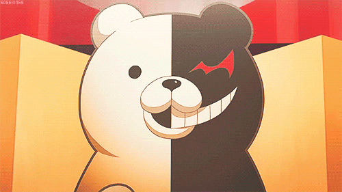

<a id="top"></a>

<div align="center">
  <a href="#profile"></a>
  <a href="#debate"></a>
  <a href="#bullets"></a>
  <a href="#trial"></a>
  <a href="#contact"></a>
</div>

<div align="center">
  
</div>

<p align="center"></p>

<div align="center">
  
</div>

<div align="center">
  <a href="https://github.com/Aspael?tab=followers">
    
  </a>
  <a href="https://github.com/Aspael?tab=repositories">
    
  </a>
  
</div>

<br>
<p align="center"></p>
<br>

<a id="profile"></a>
<h3 align="center">✦  DEVELOPER Profile — ULTIMATE PROGRAMMER</h3>

<table align="center">
  <tr>
    <td width="300" align="center">
      
    </td>
    <td width="520">

| | |
|---|---|
| **Name** | George Lucas |
| **Ultimate Talent** | 超高校級の **Back-end Developer** |
| **Class** | Systems Analysis & Development |
| **Likes** | Clean APIs, solid schemas, quiet nights |
| **Dislikes** | N+1 queries, untested pipelines, `SELECT *` |
| **Night Owl Rank** | ★★★★★ |

</td>
  </tr>
</table>

<div align="justify">

Hi! I'm **George**, graduated in **Systems Analysis and Development**. My journey in tech is driven by technical curiosity and the desire to build robust, scalable infrastructure. Right now, my main focus is the **Back-end Development** and **Data Engineering** ecosystem, where processing logic and data integrity are essential.

I've been working on efficient APIs, system architecture, and data pipelines that turn raw information into valuable insights. I believe the foundation of any great application lies in a solid back-end and well-structured data.

My experience ranges from relational and non-relational database modeling to implementing scalable services, always with a focus on **best practices**, **clean code**, and **operational efficiency**.

Like an owl, I do my best work in the quiet of the night. 🦉

</div>

```ts
const george = {
  ultimateTalent: "Back-end Developer",
  focus: ["APIs", "system architecture", "data pipelines", "database modeling"],
  weapon: "truth bullets (a.k.a. logs, tests and metrics)",
  motto: "Hope is a well-structured database.",
  activeHours: "when Monokuma's night-time announcement plays",
};
```

<br>
<p align="center"></p>
<br>

<a id="debate"></a>
<h3 align="center">☾ Nonstop Debate</h3>

<p align="center"></p>

<table align="center">
  <tr>
    <td width="260" align="center">
      
    </td>
    <td width="560">

> **"No, that's wrong!"**
>
> Code is never finished, it only gets better. What you see here is built with **practice**, **curiosity**, and **persistence**.

</td>
  </tr>
</table>

<br>
<p align="center"></p>
<br>

<a id="bullets"></a>
<h3 align="center">✧ Truth Bullets</h3>
<p align="center"><sub>Evidence collected during the investigation. Loaded and ready to fire.</sub></p>

<div align="center">

**Back-end**
<br>


<br>

**Data**
<br>


</div>

<br>
<p align="center"></p>
<br>

<a id="trial"></a>
<h3 align="center">✦ Class Trial Results</h3>
<p align="center"><sub>The Monokuma File has been updated.</sub></p>

<div align="center">
  
  <br><br>
  
  <br><br>
  
  
  <br>
  
</div>

<br>

<div align="center">
  
</div>

<br>
<p align="center"></p>
<br>

<h3 align="center">♡ Hope vs. Despair</h3>

<div align="center">
  
  
  <br>
  <sub><i>"Hope is a scalable back-end. Despair is a production deploy on Friday."</i></sub>
</div>

<br>
<p align="center"></p>
<br>

<a id="contact"></a>
<h3 align="center">✧ Connect With Me</h3>

<div align="center">
  <a href="https://www.linkedin.com/in/george-lucas-leitao/" target="_blank">
    
  </a>
  <a href="https://github.com/Aspael" target="_blank">
    
  </a>
</div>

<br>

<div align="center">
  
  <br>
  <sub><b>Upupupu... thanks for visiting. Don't forget: the night-time rule is in effect.</b></sub>
</div>

<br>

<div align="right">
  <a href="#top">
    
  </a>
</div>

<div align="center">
  
</div>
