<a id="top"></a>

<div align="center">
  <a href="#profile"></a>
  <a href="#debate"></a>
  <a href="#bullets"></a>
  <a href="#projects"></a>
  <a href="#trial"></a>
  <a href="#contact"></a>
</div>

<div align="center">
  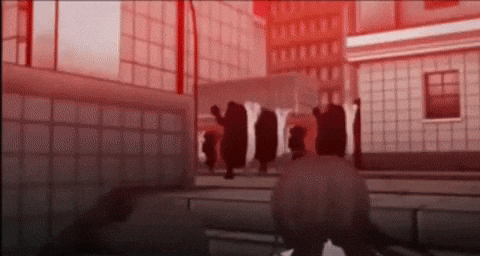
</div>

<p align="center"></p>

<div align="center">
  
</div>

<div align="center">
  <a href="https://github.com/Aspael?tab=followers">
    
  </a>
  <a href="https://github.com/Aspael?tab=repositories">
    
  </a>
  
</div>

<br>
<p align="center"></p>
<br>

<a id="profile"></a>
<h3 align="center">✦  DEVELOPER Profile — ULTIMATE PROGRAMMER</h3>

<table align="center">
  <tr>
    <td width="300" align="center">
      
    </td>
    <td width="520">

| | |
|---|---|
| **Name** | George Lucas |
| **Ultimate Talent** | 超高校級の **AI Developer** |
| **Class** | Systems Analysis & Development |
| **Likes** | Well-crafted prompts, grounded answers, quiet nights |
| **Dislikes** | Hallucinations, unevaluated models, context overflow |
| **Night Owl Rank** | ★★★★★ |

</td>
  </tr>
</table>

<div align="justify">

Hi! I'm **George**, graduated in **Systems Analysis and Development**. My journey in tech is driven by technical curiosity and the desire to build software that can think alongside people. Right now, my main focus is **AI Development** and the **LLM** ecosystem, where reasoning, context, and reliability are essential.

I've been working on LLM-powered applications, AI agents, RAG pipelines, and prompt and context engineering that turn raw models into useful, trustworthy tools. I believe a great AI product is not just a clever model, but solid engineering around it: good data, clear evaluation, and careful integration.

My experience ranges from integrating LLM APIs and building retrieval with vector databases to orchestrating agents and serving models behind scalable services, always with a focus on **best practices**, **clean code**, and **evaluations before confidence**.

Like an owl, I do my best work in the quiet of the night. 🦉

</div>

```ts
const george = {
  ultimateTalent: "AI Developer",
  focus: ["LLM applications", "AI agents", "RAG", "prompt & context engineering"],
  weapon: "truth bullets (a.k.a. evals, traces and benchmarks)",
  motto: "Hope is a model that knows when it doesn't know.",
  activeHours: "when Monokuma's night-time announcement plays",
};
```

<br>
<p align="center"></p>
<br>

<a id="debate"></a>
<h3 align="center">☾ Nonstop Debate</h3>

<p align="center"></p>

<table align="center">
  <tr>
    <td width="260" align="center">
      
    </td>
    <td width="560">

> **"No, that's wrong!"**
>
> Code is never finished, it only gets better. What you see here is built with **practice**, **curiosity**, and **persistence**.

</td>
  </tr>
</table>

<br>
<p align="center"></p>
<br>

<a id="bullets"></a>
<h3 align="center">✧ Truth Bullets</h3>
<p align="center"><sub>Evidence collected during the investigation. Loaded and ready to fire.</sub></p>

<div align="center">

**AI & LLMs**
<br>


<br>

**Serving & Tooling**
<br>


</div>

<br>
<p align="center"></p>
<br>

<a id="projects"></a>
<h3 align="center">✦ My Projects</h3>
<p align="center"><sub>Case files from the investigation. Click a Truth Bullet to open the repository.</sub></p>

<div align="center">
  <a href="https://github.com/Aspael/Bookmarkk" target="_blank"></a>
  <a href="https://github.com/Aspael/rpa-portal-transparencia" target="_blank"></a>
  <br>
  <a href="https://github.com/Aspael/between-them-entre-eles-" target="_blank"></a>
  <a href="https://github.com/Aspael/DATA-VALIDATION-API" target="_blank"></a>
  <br>
  <a href="https://github.com/Aspael/web-doctor" target="_blank"></a>
  <a href="https://github.com/Aspael/DETECTOR_PHISHING" target="_blank"></a>
  <br>
  <a href="https://github.com/Aspael/NEAR-ml-etl" target="_blank"></a>
  <a href="https://github.com/Aspael/NOTA-FISCAL_AUTOMA-O" target="_blank"></a>
  <br>
  <a href="https://github.com/Aspael/repo-testers" target="_blank"></a>
  <a href="https://github.com/Aspael/enem_bahia_analise-de-dados" target="_blank"></a>
  <br>
  <a href="https://github.com/Aspael/GrammatikLint" target="_blank"></a>
  <a href="https://github.com/Aspael/SOLID" target="_blank"></a>
  <br>
  <a href="https://github.com/Aspael?tab=repositories" target="_blank"></a>
</div>

<br>
<p align="center"></p>
<br>

<a id="trial"></a>
<h3 align="center">✦ Class Trial Results</h3>
<p align="center"><sub>The Monokuma File has been updated.</sub></p>

<div align="center">
  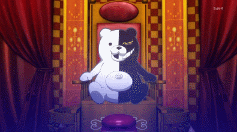
  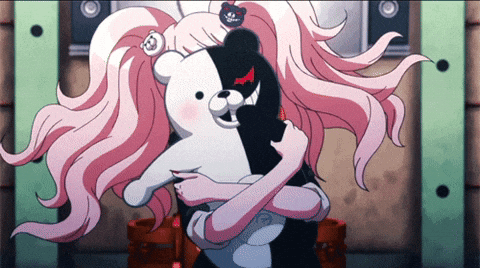
  <br>
  <sub><i>The mastermind is always watching your commits.</i></sub>
  <br><br>
  
  <br><br>
  
  
  <br>
  
</div>

<br>

<div align="center">
  
</div>

<br>
<p align="center"></p>
<br>

<h3 align="center">♡ Hope vs. Despair</h3>

<table align="center">
  <tr>
    <th width="420">✦ HOPE</th>
    <th width="420">✦ DESPAIR</th>
  </tr>
  <tr>
    <td align="center">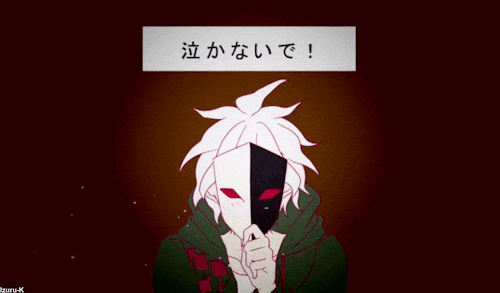</td>
    <td align="center"></td>
  </tr>
  <tr>
    <td align="center"><br><sub>Me reading the model's output in production...</sub></td>
    <td align="center">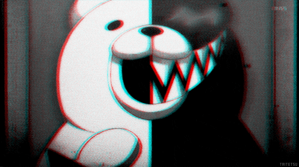<br><sub>...and finding a confident hallucination.</sub></td>
  </tr>
</table>

<p align="center"><sub><i>"Hope is a model grounded in good context. Despair is a confident hallucination in production."</i></sub></p>

<br>
<p align="center"></p>
<br>

<a id="contact"></a>
<h3 align="center">✧ Connect With Me</h3>

<div align="center">
  <a href="https://www.linkedin.com/in/george-lucas-leitao/" target="_blank">
    
  </a>
  <a href="https://github.com/Aspael" target="_blank">
    
  </a>
</div>

<br>

<div align="center">
  
  <br>
  <sub><b>Upupupu... thanks for visiting. Don't forget: the night-time rule is in effect.</b></sub>
</div>

<br>

<div align="right">
  <a href="#top">
    
  </a>
</div>

<div align="center">
  
</div>
